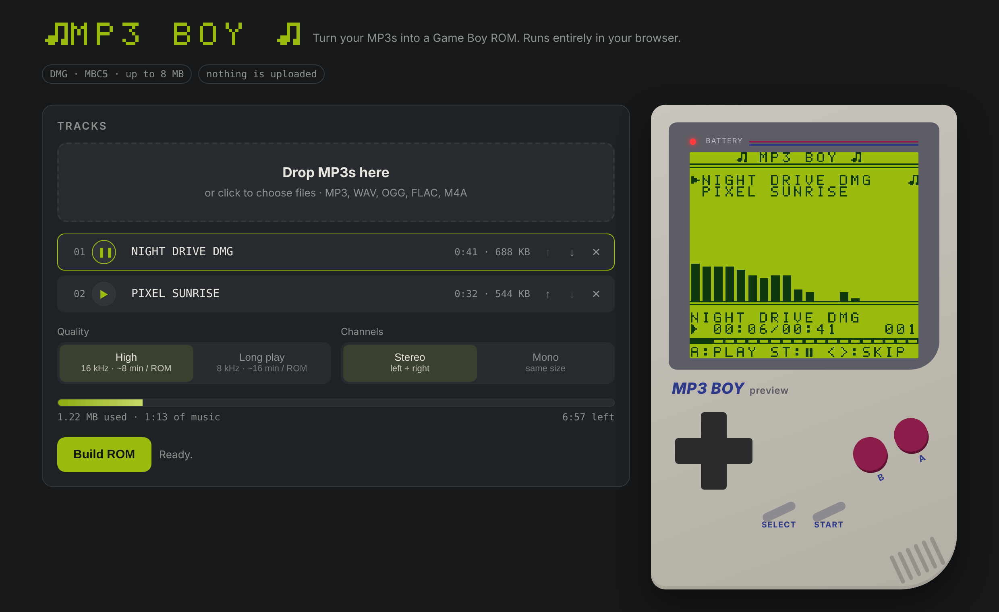
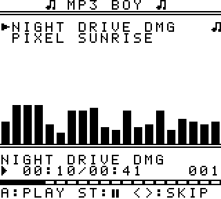
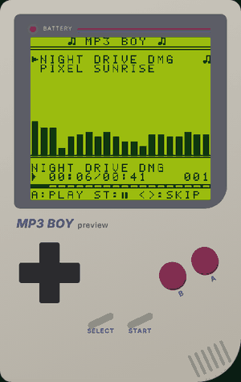

# MP3 BOY: MP3-Player für den Game Boy (DMG)

Verwandelt deine MP3s in eine Game-Boy-ROM, mit Titelliste, Steuerung und einem
Spektrum-Visualizer, der mit der Musik mitläuft. Läuft auf echter Hardware
(Flashcart mit MBC5) und in Emulatoren.



<table>
<tr>
<td align="center"><br><sub>Die fertige ROM im Emulator (SameBoy)</sub></td>
<td align="center"><br><sub>Live-Vorschau in der Web-App</sub></td>
</tr>
</table>

`mp3boy.gb` ist eine fertige ROM mit zwei Demo-Songs. Eigene ROMs baust du mit der
Web-App (`index.html`) oder dem Python-Tool (`mp3boy.py`).

## Web-Version (ohne Installation)

Öffne **`index.html`** im Browser (Doppelklick reicht, Chrome, Edge, Firefox oder Safari):

1. MP3s ins Fenster ziehen
2. Reihenfolge und Namen anpassen, Qualität wählen (High oder Long play, Stereo oder Mono)
3. Mit dem Vorschau-Game-Boy rechts reinhören (Ton und Visualizer wie auf der echten ROM)
4. **Build ROM** → `mp3boy.gb` wird heruntergeladen

Alles läuft lokal im Browser, es wird nichts hochgeladen. Python und ffmpeg braucht
man dafür nicht. Die Web-Version liefert praktisch dieselbe ROM wie das Python-Tool.

## Eigene Songs mit dem Python-Tool

Voraussetzungen: Python 3, `numpy` (`pip install numpy`) und `ffmpeg`.
Unter Windows reicht es, `ffmpeg.exe` und `ffprobe.exe` in denselben Ordner
wie `mp3boy.py` zu legen.

```
python mp3boy.py songs -o mp3boy.gb
python mp3boy.py lied1.mp3 lied2.mp3 -o mp3boy.gb
```

Optionen:
- `--lang`: Langspiel mit 8192 Hz: doppelte Spielzeit, aber dumpferer Klang
- `--mono`: Mono statt Stereo
- `--artist`: Interpret vor den Titel setzen ("ARTIST - TITLE")
- `--max-seconds 90`: jeden Song nach N Sekunden abschneiden

Als Namen nimmt das Tool den ID3-Titel, sonst den Dateinamen. Neben MP3
gehen auch WAV, FLAC, OGG, M4A usw.

**Kapazität:** 8 MB ROM ≈ 8 Minuten in bester Qualität, mit `--lang` ≈ 16 Minuten.
Bis zu 120 Titel.

## Steuerung (Anzeige auf Englisch)

| Taste          | Funktion                              |
|----------------|---------------------------------------|
| Hoch / Runter  | durch die Liste blättern (halten = schnell) |
| A              | markierten Titel abspielen / Pause    |
| START          | Pause / Weiter                        |
| B              | Stopp                                 |
| Links / Rechts | vorheriger / nächster Titel           |
| SELECT         | Cursor springt zum laufenden Titel    |

Am Ende eines Titels startet automatisch der nächste.

## Spektrum-Visualizer

20 Frequenzbänder von 60 Hz bis 7,6 kHz, mit sanft fallenden Balken. Der Game Boy
ist zu langsam für eine Echtzeit-FFT, deshalb berechnet `mp3boy.py` das Spektrum
vorher (62 Bilder pro Sekunde) und legt es an den Anfang jeder 16-KB-Bank (640 Byte,
knapp 4 % Platz). Der Player liest immer das Bild zur gerade spielenden Stelle, so
bleibt alles exakt synchron. Gezeichnet wird flackerfrei: erst wachsen von unten,
dann schrumpfen von oben.

## Auf echter Hardware

Du brauchst ein Flashcart mit **MBC5**-Unterstützung (z. B. EverDrive GB X-Serie,
EZ-Flash Junior oder ein 8-MB-MBC5-Repro-Flashcart). Die ROM läuft auf DMG,
Pocket, Color und Advance.

## Emulatoren

Getestet mit **SameBoy**. BGB, Emulicious, Gambatte und mGBA sollten den Ton
richtig wiedergeben. **PyBoy und einige einfache Emulatoren bleiben stumm**,
weil sie das Master-Volume-Register nicht emulieren.

## Wie es funktioniert

Der Game Boy kann MP3 nicht selbst dekodieren (ca. 1 MHz CPU). Deshalb macht das
PC-Tool die Arbeit. Es dekodiert mit ffmpeg, entzerrt den Klang (Präsenz,
Ausgleich der Höhendämpfung durch das Sample-and-Hold), gleicht die Lautheit an,
rechnet auf 16384 Hz um und quantisiert symmetrisch auf 8 Stufen pro Stereoseite.
Eine Rauschformung schiebt das Rauschen in tiefe Frequenzen, wo die Musik es überdeckt.
Stille liegt exakt auf einer Stufe, deshalb rauscht nichts in leisen Passagen.

Auf dem Game Boy liefert Kanal 3 (Wave) einen konstanten Pegel. Ein
Timer-Interrupt schreibt 16384-mal pro Sekunde ein Byte in das
Master-Volume-Register NR50 (Bits 6–4 links, 2–0 rechts) und moduliert damit den
Pegel zu PCM-Ton. Der Interrupt läuft selbstmodifizierend aus dem HRAM
(36 von 64 Takten). Die Audiodaten liegen in MBC5-Banks à 16 KB (= 1 Sekunde).

## Selbst bauen (optional)

`src/` enthält den Assembler-Quellcode (`player.asm`), den Font-Generator, die Vorlage
der Web-Version (`web_template.html`) und `build.sh`. Für den Build brauchst du [RGBDS](https://rgbds.gbdev.io).
`build.sh` erzeugt `mp3boy.py` und `index.html` mit eingebetteter Player-ROM neu.
